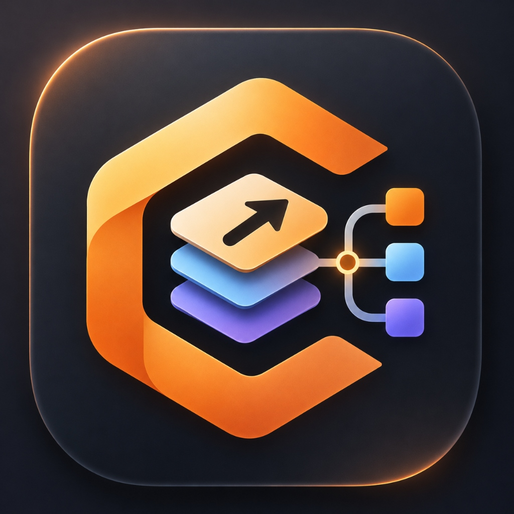
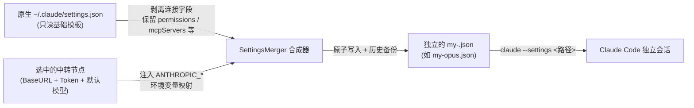

# CC 多实例配置器 (CC Multi-Instance Configurator)

<div align="center">



**专为 Claude Code (CC) 打造的跨平台多实例配置与中转节点管理工具**

基于 **Tauri 2 + Vue 3 + TypeScript + Rust** 构建，轻量、安全、非侵入式。

[核心特性](#-核心特性) • [痛点与解决方案](#-为什么需要-cc-多实例配置器) • [工作原理](#-核心工作流与架构) • [目录规范](#-配置文件存放规范) • [快速开始](#-快速开始)

</div>

---

## 📖 为什么需要 CC 多实例配置器？

在使用 **Claude Code** 终端命令行工具时，开发者常遇到以下实际痛点：

| 常见痛点 | 传统做法的隐患 | CC 多实例配置器的解决方案 |
| :--- | :--- | :--- |
| **多模型 / 多中转站切换繁琐** | 手动打开 `settings.json` 反复修改 `ANTHROPIC_BASE_URL`、Token 与模型名称 | **一键选择分组与节点**，系统自动完成参数映射与配置合成 |
| **基础配置易被污染或损坏** | 经常改写全局配置文件，容易误删 `permissions`、`hooks`、`mcpServers` 等重要字段 | **严格只读保护** 原生 `settings.json`，只剥离连接覆盖字段，完整保留自定义业务配置 |
| **多环境无法同时并行运行** | 全局只有一份配置文件，无法在不同终端同时以不同配置运行多个会话 | **生成独立的 `my-<slug>.json`**，配合 `claude --settings` 参数实现真正互不干扰的多实例会话 |
| **中转节点状态未知** | 节点网络是否可达、延迟高低无法直观感知 | 内置 **HTTP / HTTPS 节点测速引擎**，自动兼容原生 IP 地址与自建反代，实时反馈延迟 |

---

## ✨ 核心特性

- 🖥️ **原生纯净桌面体验**：
  - 基于 **Tauri 2 + Rust** 深度优化，秒速启动、极低内存占用。
  - 现代化卡片式原生布局，无多余滚动条，全界面自适应。
- 🛡️ **非侵入式配置合成 (Non-destructive Merge)**：
  - 以用户现有的 `~/.claude/settings.json` 作为基础模板，采用字段白名单剥离机制，**永不篡改原始全局配置**。
  - 写入操作采用 **临时文件 + 原子替换 (Atomic Replacement)**，杜绝断电或并发写入导致配置文件损坏。
  - 自动保留各分组最近 10 次修改的历史时间戳快照（`backups/`），安全无忧。
- 🌐 **中转节点集中管理与测速**：
  - 集中维护 API Base URL、Token 与默认模型。
  - 默认模型修改后，自动无缝同步映射至 Opus、Sonnet 与 Haiku 配置。
  - 智能测速兼容原生 IP 节点（`https://x.x.x.x`）与网关重定向，精准显示毫秒级延迟与错误诊断。
- 💻 **跨平台自动识别与动态命令**：
  - 启动时自动感知宿主系统（Windows / macOS / Linux）。
  - **Windows** 自动适配 `%USERPROFILE%\.claude\my-<slug>.json` 规范。
  - **macOS / Linux** 自动适配 `~/.claude/my-<slug>.json` 规范。
  - 主界面与设置页面支持实时点击切换系统预览，一键复制标准启动命令。
- ⚙️ **灵活的配置目录支持**：
  - 支持官方默认目录自动检测，也支持自定义配置目录浏览选择。
  - 纯净过滤内部点文件，直观预览并支持在线查看与编辑 JSON 配置。

---

## 🏗️ 核心工作流与架构

### 1. 配置合并机制



### 2. 软件整体技术分层

```text
┌────────────────────────────────────────────────────────┐
│ Vue 3 前端 (TypeScript + Native Clean Theme)           │
│ 模型分组选择 | 节点测速管理 | 动态启动命令一键复制 | 设置管理      │
└───────────────────────────┬────────────────────────────┘
                            │ Tauri 2 IPC Commands
┌───────────────────────────▼────────────────────────────┐
│ Rust 业务核心与系统底层                                │
│ ├── PathResolver    : 跨平台路径探测、安全 Slug 校验     │
│ ├── GroupStore      : 分组持久化、my-*.json 独立生命周期 │
│ ├── NodeStore       : 中转站节点配置与跨组复用            │
│ ├── SettingsMerger  : 基础配置白名单剥离与原子合并       │
│ ├── BackupService   : 时间戳快照轮转 (保留最近 10 次)    │
│ ├── NodeTester      : 异步 HTTP/HTTPS 测速 (支持 IP/反代)│
│ └── OsDetector      : 宿主系统环境识别与路径宏替换       │
└────────────────────────────────────────────────────────┘
```

---

## 📁 配置文件存放规范

本工具严格遵循各操作系统的标准应用数据存放规范：

| 配置类型 | Windows 路径 | macOS / Linux 路径 | 作用说明 |
| :--- | :--- | :--- | :--- |
| **应用自身数据** | `%APPDATA%\CCConfig\` | `~/Library/Application Support/CCConfig/` | 存储启动器自身的分组列表（`config.json`）、中转节点库（`nodes.json`）与快照历史（`backups/`） |
| **Claude 基础配置** | `%USERPROFILE%\.claude\settings.json` | `~/.claude/settings.json` | 用户原生配置（**只读**，仅用于提取用户自定义权限和配置模板） |
| **各分组独立配置** | `%USERPROFILE%\.claude\my-<slug>.json` | `~/.claude/my-<slug>.json` | 启动器合成输出的文件（如 `my-opus.json`），独立供给 Claude 运行 |

> 💡 **数据无损迁移提示**：若此前运行过旧版目录 `ClaudeLauncher`，程序启动时会自动识别并无损平滑迁移至 `CCConfig`。

---

## 🚀 快速开始

### 开发环境要求
- **Node.js**: v18+ (推荐 v20+)
- **pnpm**: v9+ 或 v10+
- **Rust**: 1.80+ (推荐最新稳定版 `cargo 1.85+`)
- **Claude Code**: 确保已通过 npm 全局安装并可在终端执行 `claude`

### 1. 克隆项目与安装依赖
```bash
git clone https://github.com/your-repo/claude-multi-instance-launcher.git
cd claude-multi-instance-launcher
pnpm install
```

### 2. 运行桌面开发调试环境
```bash
pnpm tauri dev
```

### 3. 构建发布安装包
```bash
pnpm tauri build
```
构建产物将输出在 `src-tauri/target/release/` 目录下。

### 4. 直接运行本地已编译版本
在 Windows 下可直接双击运行现成的可执行文件：
```powershell
.\src-tauri\target\release\cc-multi-config.exe
```

---

## 🧪 自动化测试

项目对 Rust 底层的核心安全性与合并算法提供了严格的单元测试：

```bash
cargo test --manifest-path src-tauri/Cargo.toml
```

- ✅ `test_slug_sanitization`：验证分组英文标识规范化，过滤非法字符，拦截 Windows 系统保留名（CON、PRN、AUX、NUL 等）。
- ✅ `test_clean_managed_fields_preserves_user_settings`：验证从基础 `settings.json` 中完整剥离连接字段的同时，100% 保留 `permissions`、`hooks` 等自定义设置。
- ✅ `test_merge_node_to_settings`：验证中转节点信息（URL、Token、默认模型）精确映射并写入各版本环境变量。
- ✅ `test_preview_diff_masks_token`：验证敏感 API Token 在差异日志与预览中全程以星号掩码脱敏。

---

## 📄 开源许可

本项目遵循 [MIT License](LICENSE) 开源协议。

